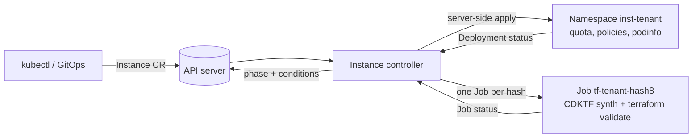

# fleet-operator

A small Kubernetes operator (kubebuilder, Go) that manages a fleet of single-tenant environments as custom resources, and renders (but never applies) per-tenant Terraform with CDK for Terraform.

> **This is a learning project.** It is not production software, has no users, and makes no claims about scale. It is **not affiliated with Sourcegraph**, and **no Sourcegraph code was copied**. The architecture is inspired by public material (see [Inspiration](#inspiration)). It never needs cloud credentials: Terraform is only synthesized and run through `terraform validate`.

## What it does

You create one cluster-scoped `Instance` per tenant:

```yaml
apiVersion: fleet.example.com/v1alpha1
kind: Instance
metadata:
  name: acme
spec:
  tenant: acme        # becomes namespace inst-acme (immutable)
  version: "6.7.0"    # podinfo image tag
  size: small         # small | medium | large -> quota + resources
  ring: internal      # internal | trial | prod (a label for now)
  connectivity:       # optional
    mode: psc         # none | psc | privatelink (placeholder)
    allowedProjects: [example-consumer-project]
```

The controller reconciles it into:

- a **namespace** `inst-<tenant>` with a ServiceAccount, ResourceQuota, a default-deny NetworkPolicy plus an explicit allow rule, a Deployment (podinfo) and a Service, applied with server-side apply;
- a **Kubernetes Job** `tf-<tenant>-<hash8>` that runs CDKTF to synthesize GCP Terraform and then `terraform validate`.

`status` reports `phase` (`Pending|Provisioning|Ready|Failed|Deleting`), `observedGeneration`, `terraformHash`, `lastTaskName` and the conditions `Ready`, `KubernetesReady`, `TerraformRendered`, `TerraformValidated`. Deleting an `Instance` runs a finalizer that removes the namespace and waits until it is gone.



More detail: [docs/ARCHITECTURE.md](docs/ARCHITECTURE.md) and the [decision records](docs/adr/). A write-up of what I learned: [docs/blog.md](docs/blog.md).

## Quickstart

Needs Docker, [kind](https://kind.sigs.k8s.io/), kubectl, Go and `make`. The first run downloads images and the Terraform Google provider, so expect several minutes.

```bash
make deploy-kind                              # kind cluster, build + load both images, deploy the operator
kubectl apply -f config/samples/              # three Instances, one per ring
kubectl get instances -w                      # Provisioning -> Ready
kubectl get ns | grep inst-                   # one namespace per tenant
kubectl -n fleet-operator-system get jobs     # the per-instance Terraform tasks
```

Try an upgrade (`kubectl patch instance acme --type=merge -p '{"spec":{"version":"6.7.1"}}'`) and a delete (`kubectl delete instance globex`; its namespace disappears). Clean up with `make kind-down`.

## Development

| Command | What it does |
|---|---|
| `make test` | unit + envtest tests (needs Linux or a Linux container for envtest, and Node for the CDKTF tests) |
| `make test-linux` | the same inside a Linux container via Docker (useful on Windows) |
| `make lint` | golangci-lint (use the Go version from `go.mod`) |
| `make e2e` | create a kind cluster, deploy, run the end-to-end test, delete the cluster |

## Design decisions

| Decision | Why |
|---|---|
| Cluster-scoped `Instance`, one per tenant | a cluster-scoped owner can own the tenant namespace |
| Pure render functions with golden tests | most logic is testable without a cluster |
| Server-side apply, dry-run compared before writing | idempotent, drift-correcting, no writes in steady state |
| Finalizer that waits for the namespace to be gone | deletion is observable and re-entrant |
| Terraform runs in a separate Job image | CDKTF needs Node (jsii); keeps the manager a small Go binary |
| Job name `tf-<tenant>-<hash8>` | one Job per (instance, input hash); creating it is idempotent |
| envtest for the reconciler, kind for readiness | envtest has no controllers, so rollouts are only proven in kind |

## What this is not

- Not production-grade. Single-replica podinfo, no persistence, no ingress, no real tenant workload.
- Not Sourcegraph's implementation, and not a description of how Sourcegraph works internally.
- Terraform is never applied. The `psc` output has never been run against a real GCP project, and `privatelink` is a labelled placeholder that renders only an output saying it is not implemented.
- The ring-based rollout controller (`FleetRollout`) was **not built**. The `ring` field is currently just a label and a hash input.
- CDKTF has been announced as deprecated by HashiCorp; it is used here to learn how it behaves, not as a recommendation.
- Tested on Kubernetes 1.34 (envtest and kind). Not tested elsewhere.

## Inspiration

- Robert Lin's 2024 post on scaling Sourcegraph's managed multi-single-tenant product (cited by title; I could not find a live URL to link).
- [Building Sourcegraph Cloud as a single-tenant solution](https://sourcegraph.com/blog/single-tenant-cloud)
- [Sourcegraph Cloud docs](https://sourcegraph.com/docs/cloud), including the private connectivity pages.

## License

Apache 2.0 (kubebuilder scaffold headers). See [LICENSE](LICENSE).
