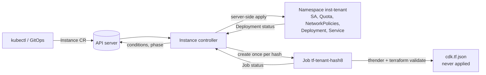

# Architecture

> `fleet-operator` is a learning project. It is not production software and is not affiliated with Sourcegraph. See the [README](../README.md).

## Shape

One cluster-scoped `Instance` custom resource per tenant. A single controller (`internal/controller`) turns each `Instance` into:

1. **Kubernetes objects**: namespace `inst-<tenant>` with a ServiceAccount, ResourceQuota, default-deny NetworkPolicy plus an explicit allow rule, a Deployment and a Service (podinfo). Rendered by the pure function `internal/render/k8s.Render` and applied with server-side apply.
2. **A Terraform "task"**: a Kubernetes Job (`tf-<tenant>-<hash8>`) that synthesizes Terraform JSON with CDKTF (`cmd/tfrender`, `internal/render/tf`) and runs `terraform init -backend=false && terraform validate`. Nothing is ever applied.

## Reconcile order

1. Get the `Instance`; stop if not found.
2. If deleting: phase `Deleting`, delete the namespace, requeue until it is gone, remove the finalizer `fleet.example.com/cleanup`.
3. Ensure the finalizer.
4. Render and server-side-apply the Kubernetes objects (a dry-run apply is compared first so steady state persists no writes). Refuse to adopt a pre-existing `inst-<tenant>` namespace that this operator did not create (`NamespaceConflict`, phase `Failed`).
5. Compute the Terraform input hash (`internal/render/tfhash`: tenant, region, ring, connectivity; not version or size). If it changed, create the Job for that hash (a name collision means it already exists, which is success). Read Job status into `TerraformRendered` / `TerraformValidated`.
6. Compute `phase`. `Ready` only when `KubernetesReady` and `TerraformValidated` are both true for the current hash. A failed task Job is terminal (`Failed`); changing the spec produces a new hash and a new Job.
7. Write status only if it changed. Emit Events on phase transitions. Requeue only while waiting.

## Status

`phase`, `observedGeneration`, `terraformHash`, `lastTaskName`, and conditions `Ready`, `KubernetesReady`, `TerraformRendered`, `TerraformValidated`.

## Packages

| Package | Role |
|---|---|
| `api/v1alpha1` | `Instance` types and CEL/kubebuilder validation |
| `internal/render/k8s` | pure Kubernetes object rendering (golden tests) |
| `internal/render/tfhash` | Terraform input hash; no CDKTF dependency, so the manager binary does not link jsii |
| `internal/render/tf` | CDKTF stack synthesis (needs Node at runtime) |
| `cmd/tfrender` | CLI used inside the task Job |
| `internal/controller` | reconciler and Job builder |

## Testing pyramid

- **Unit**: renderers (golden files), hash, Job builder.
- **envtest**: API validation and the reconciler. envtest has an API server and etcd but no controllers: Deployments never become available, Jobs never run, namespaces never finish terminating. Tests set those statuses by hand (and clear the namespace finalizer through the `finalize` subresource), so they prove the reconciler's *logic*, not real rollouts.
- **kind e2e** (`make e2e`): three Instances reach Ready, a version bump rolls out, a deletion cleans up. This is the only layer that exercises real readiness and real Job execution.

## Known limits

- Single replica podinfo; no persistence, no ingress, no real tenant data path.
- A `NamespaceConflict` is not retried automatically; deleting the foreign namespace then touching the `Instance` re-triggers reconciliation.
- A completed task outcome is read from status; if its Job is garbage collected after the TTL, it is not rerun until the hash changes.
- `privatelink` is a labelled placeholder that renders only an output saying it is not implemented. `psc` renders an address and forwarding rule that reference a `service_attachment_uri` variable you would have to supply; it has never been applied against a real project.
- CDKTF has been announced as deprecated by HashiCorp. It is used here as a learning exercise.
- No webhook, no leader-election tuning, no metrics dashboards, no multi-cluster.
